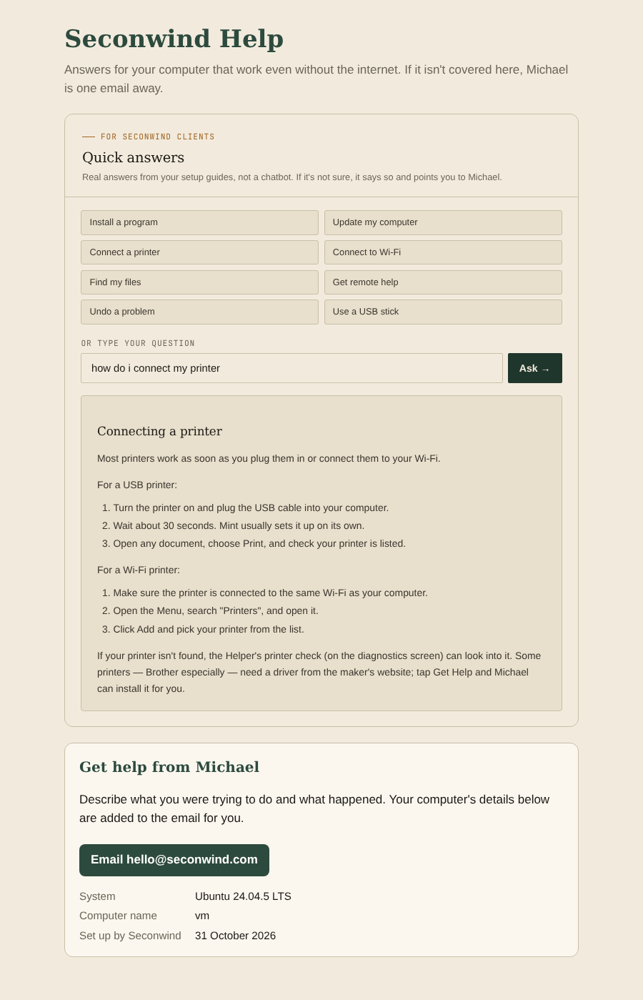

# Seconwind Help

The website's **Quick answers** as an offline app on the customer's computer. "Seconwind Help" appears in their menu (and optionally on their desktop). It opens in Firefox, answers common questions from the same 12 guides as the website, and when it isn't sure it offers an **Email Michael** button. That email is pre-filled with the computer's model, Linux version and name.



It works without internet, sends nothing anywhere, and needs nothing installed.

## Install on a customer's machine

From the kit USB or a clone of this repo:

```bash
sudo ./install/install.sh customer-username
```

This puts the app in `/opt/seconwind-help/`, adds a menu entry and, for that user, a desktop icon. Remove it with `sudo ./install/uninstall.sh customer-username`.

## Keeping it in step with the website

The guides and matching logic are copied from the website's `index.html` at build time, so the two never drift apart:

```bash
python3 tools/build.py ../seconwind-site/index.html   # writes dist/index.html
python3 -m unittest discover -s tests
```

Rebuild and commit `dist/index.html` whenever you change the Guides on the website. The build stops with a clear message if the Guides module has moved or its markup has changed. The only change from the website version is that "Send Michael a message" becomes an email link, because the contact form needs the internet.

## Files

- `tools/template.html`: the page shell (layout, "Get help from Michael" card).
- `tools/build.py`: pulls the Guides CSS, knowledge base and script out of the website.
- `dist/index.html`: the built app, committed so it can be installed without the website repo.
- `install/`: installer, uninstaller and icon.
